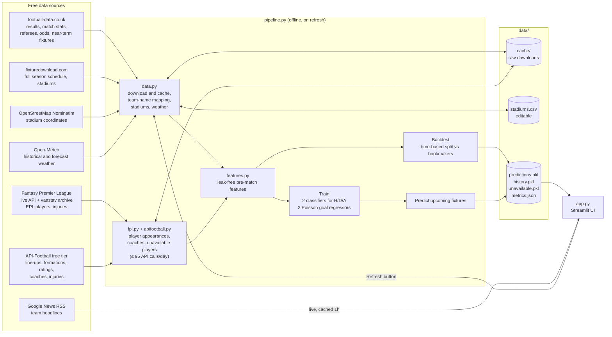

# Football Oracle

Predicts football match results for seven European leagues: Premier League, La Liga, Serie A, Bundesliga, Ligue 1, Eredivisie and Süper Lig. It uses machine learning trained on every league match since 2015/16.

For each upcoming fixture it gives home / draw / away probabilities and the most likely score. A local web UI shows the reasoning behind each prediction:

- form, head-to-head and referee
- expected line-ups and who is injured or suspended
- the managers' records
- weather, odds and the latest news

## Purpose

This is a personal, educational project. It explores how far a match predictor can get using **only free data**: public files, the unofficial Fantasy Premier League API and API-Football's free tier. Anyone can clone it and run it.

It's built to be honest about its accuracy. Each training run is checked against the bookmakers' odds on matches the model has never seen, and the result is shown in the UI. It is not betting advice.

## Quick start

Requires Python 3.12+.

```bash
python -m venv .venv
# Windows
.venv\Scripts\pip install -r requirements.txt
.venv\Scripts\streamlit run app.py
# macOS / Linux
.venv/bin/pip install -r requirements.txt
.venv/bin/streamlit run app.py
```

The first launch downloads about 11 seasons of data, geocodes the stadiums and trains the models. This takes several minutes. After that, click **Refresh data & retrain** in the sidebar (or run `python pipeline.py`) to pull new results and fixtures. Run the tests with `pytest`.

### API-Football key (optional, recommended)

Premier League player data comes from Fantasy Premier League and needs no key. For line-ups, formations, player ratings, managers and injuries in the other six leagues, get a free key at [dashboard.api-football.com](https://dashboard.api-football.com) and set it before starting:

```bash
# Windows (new terminals)
setx APIFOOTBALL_KEY your_key
# macOS / Linux
export APIFOOTBALL_KEY=your_key
```

The free plan allows 100 requests a day. Every response is cached on disk, and the app stops at 95 requests a day (change it with `APIFOOTBALL_DAILY_BUDGET`), so history builds up over the first few days of refreshes. The sidebar shows today's usage and how many matches have line-ups so far. The free plan also limits which seasons are available. The app reads those limits from the API's replies and skips the blocked seasons.

## What you get

- **Fixture list:** every upcoming fixture in the chosen leagues and date range, with model probabilities, predicted winner, most likely score, the bookmakers' implied probability, and the model-minus-market *edge*.
- **Match view** (click a row):
  - probabilities against the market, and expected goals
  - side-by-side team form: Elo, points, goals, shots, corners, cards, home or away form, rest days
  - squad and manager: current manager and record, regular starters missing, line-up form, formation
  - every injured, suspended or doubtful player with the reason (e.g. "Hamstring injury - Expected back 1 Nov")
  - head-to-head record, recent results, referee tendencies, weather forecast and odds
  - latest news for both teams, with injury, suspension and manager stories flagged ⚠️
- **Model accuracy:** the backtest table described below.

## Architecture



The work happens offline in `pipeline.py`. The UI reads only the saved predictions and history, so it loads instantly; the only thing it fetches live is news. The data flow:

1. **`data.py`** downloads results and odds for every season and league, plus the near-term fixtures with odds (`fixtures.csv`).
2. It also downloads the full season schedule from fixturedownload.com and maps its team names onto football-data's naming.
3. It geocodes each home stadium once, then fetches daily weather at each one.
4. **`fpl.py`** turns Fantasy Premier League data into one row per player per Premier League match (started or not, minutes, BPS performance score), plus the current list of injured and suspended players. **`apifootball.py`** does the same for the other leagues: line-ups, player ratings, formations, coach careers and injuries. It spends at most the daily request budget.
5. **`features.py`** adds the upcoming fixtures, with blank results, to the played matches and computes every feature from earlier matches only.
6. **`pipeline.py`** backtests on the most recent seasons, retrains on all history and writes predictions for every unplayed fixture.
7. **`app.py`** displays them.

## Features used by the model

| Factor | Feature | Source |
|---|---|---|
| Club strength | Elo rating, updated after every match and weighted by goal margin | derived from results |
| Recent form | Points, goals, shots, shots on target, corners, fouls and cards, averaged over the last 5 and 10 matches | football-data.co.uk |
| Home / away form | Each team's last 5 matches at the same venue type (home team at home, away team away) | football-data.co.uk |
| Head-to-head | Last 6 league meetings: win rate, draw rate, average goal difference | football-data.co.uk |
| Referee | Home-win rate, cards per game, number of matches refereed | football-data.co.uk (England only) |
| Betting market | Average bookmaker odds converted to probabilities, with the bookmaker margin removed | football-data.co.uk |
| Weather | Max temperature, precipitation and max wind at the home stadium on match day | Open-Meteo |
| Fatigue / season stage | Days since last match, league games played this season | derived |
| Line-up strength | Number of the team's 11 regular starters (most starts in its previous 10 matches) not in the XI | FPL (EPL), API-Football |
| Player form | Average recent form of the XI: each player's last 5 ratings, standardised per source (FPL BPS / API-Football rating) | FPL (EPL), API-Football |
| Formation | Number of defenders and forwards | API-Football |
| Manager | Manager's league games in the dataset, points per game, games at this club, days in the job | API-Football coach careers + results |
| League | League code, so each league can behave differently | |

For **upcoming** matches the XI isn't known until about an hour before kick-off. Until then the expected XI is the team's regular starters minus anyone injured, suspended or doubtful (<75% chance of playing). The UI lists exactly who is missing.

### Not in the model

| Factor | Why not | Partial stand-in |
|---|---|---|
| News | No historical news archive to train on | Shown in the UI, keywords flagged; injury news enters through the FPL / API-Football availability data |
| Pitch quality | No dataset exists | Each team's home form |
| Player data before 2016/17 (EPL) or before the free plan's seasons (other leagues) | Not in the free sources | The model treats those matches as having no player data |

## Design decisions

**Free data only, and only one sign-up.** Everything except API-Football works without a key. The app runs without the key too; it just has no player or manager data outside the Premier League.

**Fantasy Premier League for the Premier League.** FPL's unofficial API is free, has no rate limit worth worrying about, and publishes every player's injury or suspension status with a news line. The [vaastav/Fantasy-Premier-League](https://github.com/vaastav/Fantasy-Premier-League) archive adds per-match player data back to 2016/17. That's 10 seasons of line-ups and player ratings, far more than API-Football's free plan allows. FPL's BPS (bonus points system) score, built from about 30 Opta stats per match, serves as the player rating.

**API-Football for everything else, rationed and cached.** The free tier is 100 requests a day, so each request is made to count. Requests are spent in priority order:

1. season fixture lists (one call per league)
2. coach careers (one call per team, refreshed every 14 days)
3. injuries (one call per league per day)
4. full match details, which return line-ups, formations and player ratings for **20 matches per request**

Responses are cached on disk forever (lists and injuries are refreshed daily), so each day's budget adds new data instead of repeating old requests. A counter, synced with the API's own rate-limit headers, stops at 95. When a season is blocked by the plan, that's learned from a single request and remembered.

**Managers from coach careers, not per-match line-ups.** API-Football's coach endpoint is queried by team, not season, so the free plan's season limits don't apply to it. Each coach's start and end dates at a club are matched against football-data's results, which gives every match since 2015 a manager, along with his record from earlier matches.

**Line-up features that also work before the line-up is known.** "Regular starters missing" is defined the same way for history (who actually started) and for upcoming matches (who is unavailable). The model learns how much missing regulars matter, and a prediction uses the latest injury list. One trade-off: in history the count also includes rotation, which can't be known in advance.

**Gradient-boosted trees (scikit-learn `HistGradientBoosting*`).** The data is about 27k rows of mixed numbers, a good fit for boosted trees. They handle missing values natively, which matters here. Referees are only published for England, shot statistics are missing for the 2015/16 and 2016/17 Eredivisie and Süper Lig seasons, and weather is unavailable for some stadiums. Missing values go straight to the model; nothing is filled in. The league is used as a native categorical feature.

**One feature pipeline for past and future matches.** Upcoming fixtures are added to the match history with blank results, and every feature is computed with `shift(1)`. A match's features therefore come only from earlier matches, whether it was played years ago or kicks off tomorrow. This prevents the most common bug in sports models, leaking the result into the features. It also guarantees training and prediction use identical code. `test_features.py` asserts the no-leakage property.

**Bookmaker odds are both a feature and the yardstick.** The betting market is the strongest single predictor available, so the model uses it as a feature. Accuracy is also reported against it: matching the market is a good result, and beating it consistently is rare.

**Two classifiers: with and without odds.** Bookmakers publish odds only a few days ahead. Fixtures further out are scored by a second model trained without the odds features. The UI notes this, and the backtest reports both models.

**Time-based backtest, not a random split.** The models train on seasons before last season and are tested on last season plus the current one. A random split would let the model learn from matches played after the ones it is tested on.

**Scoreline from Poisson goal models, constrained to the predicted outcome.** Two Poisson regressors predict expected goals for each side. The displayed score is the most likely scoreline among those that agree with the predicted winner. This avoids showing "Home win, 1-1".

**Elo rating with a goal-margin multiplier.** Elo is a cheap, proven measure of team strength (K = 20, home advantage 60 points). Promoted teams start at 1400 rather than 1500, because newly promoted sides are usually weaker than average.

**Flat files instead of a database or server.** This is a single-user local tool, so cached CSVs plus pickled outputs are enough. Streamlit provides the UI with no front-end build step.

**Team-name mapping: fuzzy matching plus aliases.** The two fixture sources spell clubs differently ("Manchester United" vs "Man United"). Names are fuzzy-matched within each league, and an `ALIASES` table in `data.py` overrides the known failures. If two names map to the same club, a warning tells you which alias to add.

**Stadiums are geocoded once and stored in an editable CSV.** Lookups are limited to the league's country, which prevents results such as a "Johan Cruyff Arena" in Malta. Manual corrections in `data/stadiums.csv` are never overwritten.

**Weather history fills in gradually.** Open-Meteo's free quota counts an 11-year daily history as many calls. At the first rate-limit response, the pipeline stops downloading history for that run and still fetches forecasts. Each refresh completes more stadiums. Until then, those matches have no weather data, and the model handles that like any other missing value.

## Results

Backtest from 13 Oct 2026: trained on 2015/16–2024/25, tested on 2,796 matches from 2025/26 and 2026/27 that have odds.

| | Accuracy | Log loss (lower is better) |
|---|---|---|
| Model (with odds) | 53.0% | 0.980 |
| Model (no odds) | 52.1% | 0.991 |
| Bookmakers | 53.3% | 0.977 |
| Always pick home win | 43.6% | – |

The model is roughly level with the bookmakers. That is typical: football has a lot of randomness, and the market already includes information this model can't see, such as line-ups and injuries. Each retrain refreshes these numbers in the UI.

## Project layout

```
app.py             Streamlit UI
pipeline.py        backtest, training, prediction (entry point: python pipeline.py)
features.py        pre-match feature engineering (form, Elo, h2h, referee, line-ups, managers)
data.py            results, odds, fixtures, team-name mapping, stadiums, weather
fpl.py             Premier League players and availability from Fantasy Premier League
apifootball.py     line-ups, ratings, formations, coaches, injuries; cache + daily budget
test_*.py          no-leakage, line-up, manager, API budget/parsing and scoreline tests
data/stadiums.csv  geocoded stadiums (committed, hand-editable)
data/cache/        raw downloads and API responses (git-ignored)
```

**Adding a league:** add a line to `LEAGUES` in `data.py`. It needs the football-data.co.uk code, a display name, the fixturedownload.com slug and a country code, for example `"P1": ("Primeira Liga", "primeira-liga", "pt")`. Add the API-Football league id to `LEAGUE_IDS` in `apifootball.py` (`"P1": 94`), then retrain.

## Notes

- `scikit-learn` is pinned to 1.8.0 because Windows Smart App Control blocks a compiled file in 1.9.1.
- Data comes from [football-data.co.uk](https://www.football-data.co.uk), [fixturedownload.com](https://fixturedownload.com), [Fantasy Premier League](https://fantasy.premierleague.com) (unofficial API), [vaastav/Fantasy-Premier-League](https://github.com/vaastav/Fantasy-Premier-League), [API-Football](https://www.api-football.com), [OpenStreetMap](https://www.openstreetmap.org/copyright), [Open-Meteo](https://open-meteo.com) and Google News. Please respect their terms and rate limits.
- Predictions are probabilities, not certainties. Don't use them for gambling decisions.
